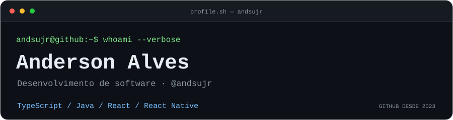
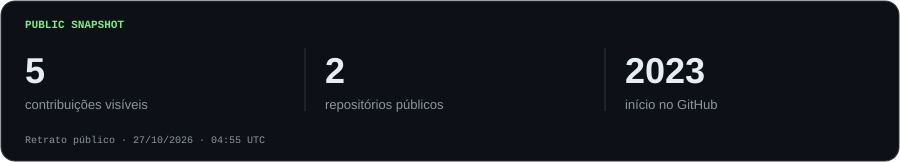
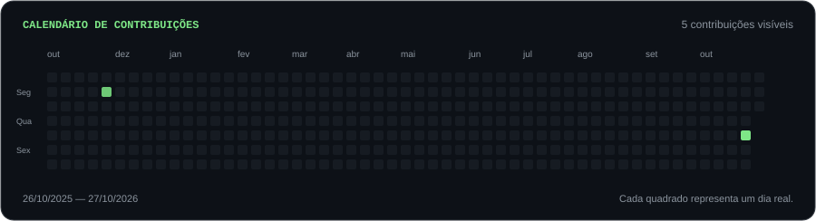

  <picture>
    <source media="(max-width: 600px)" srcset="./assets/header-mobile.svg" />
    
  </picture>

  <a href="https://github.com/andsujr?tab=repositories"><code>Repositórios</code></a>
  &nbsp;&middot;&nbsp;
  <a href="https://github.com/andsujr"><code>@andsujr</code></a>

## `$ cat about.md`

Sou **Anderson Alves**, desenvolvedor de software. Trabalho com **TypeScript, Java** e uso **Linux, Git e GitHub** no meu ambiente de desenvolvimento.

Também tenho experiência com **React** para interfaces web e **React Native** para aplicações móveis.

## `$ ls ~/stack`

`TypeScript` · `Java` · `React` · `React Native` · `Git` · `GitHub` · `Linux`

## `$ gh dashboard --public`

<picture>
  <source media="(max-width: 600px)" srcset="./assets/overview-mobile.svg" />
  
</picture>

## `$ cat contributions.log`

Fontes, atualização e privacidade

Os indicadores e o calendário são snapshots de **27/10/2026 · 04:55 UTC** e não se atualizam sozinhos. Usam apenas o perfil público e o calendário acessível sem login. A stack é uma seleção das tecnologias com que trabalho, não um ranking de linguagens. Nenhum nome ou conteúdo de repositório privado é exibido. [Fontes das imagens](./assets/SOURCES.md).

---

<code>andsujr@github:~$ exit 0</code>

