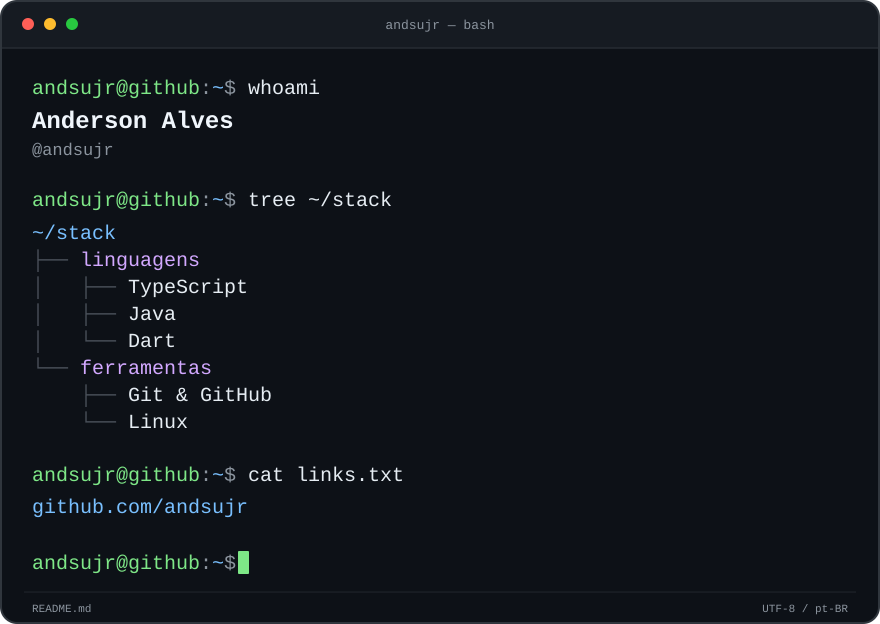

  

  <a href="https://github.com/andsujr?tab=repositories"><code>~/repositorios</code></a>
  &nbsp;&middot;&nbsp;
  <a href="https://github.com/andsujr/agenor-releases/releases"><code>~/releases</code></a>

### `$ ls ~/public`

| Projeto | Descrição |
| :--- | :--- |
| [**Agenor**](https://github.com/andsujr/agenor-releases) | Distribuição oficial do Agenor: instaladores e atualizações. |

---

<code>andsujr@github:~$ exit 0</code>

